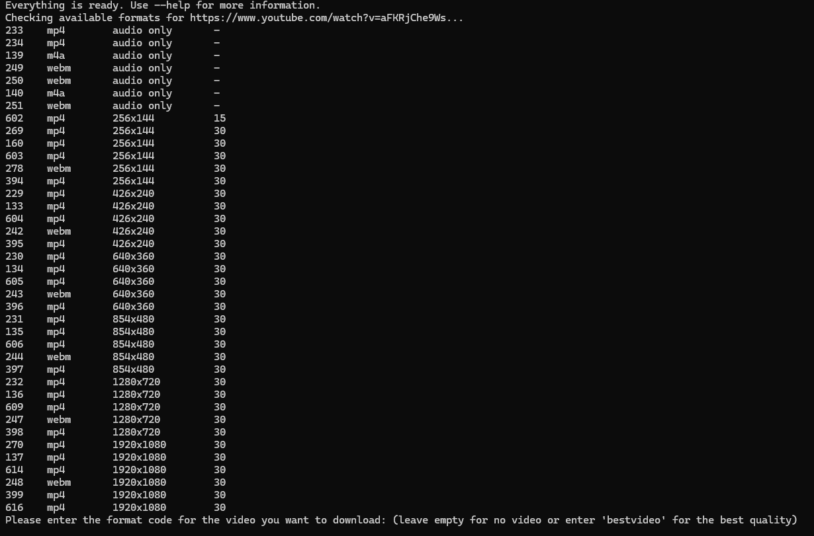

# bash-video-downloader
A video downloader script using yt-dlp

## Informations
This BASH script allows you to download videos from many websites using yt-dlp on Linux.
It was designed for Debian-based Linux systems.

Please only download content that you own or have permission to download. Respect copyright laws and the terms of service of the websites you use.
The user is solely responsible for ensuring that their downloads are legal.

## First use
Download the video_downloader.sh from this github repo: https://github.com/zoardgodor/bash-video-downloader/releases
It is recommended to place the script in a separate folder, e.g., vdownloader.
Enter the folder:
```bash
cd vdownloader
```
Make the script executable:
```bash
chmod +x video_downloader.sh
```
For the first run, run the script without any flags:
```bash
./video_downloader.sh
```
The script checks for the presence of ffmpeg. If it is not found, it installs it using apt. (If you are not using a Debian-based system, select "no" (n) before the installation, and install it manually.)
After this, the script checks whether a yt-dlp binary in its folder. In all likelihood, it won't be.
If it's not there, do this: (The script will also ask you to do this)

Download yt-dlp_linux from https://github.com/yt-dlp/yt-dlp/releases
Rename it to yt-dlp and put it next to the script.

After this, if you run it and it says "Everything is ready," then it is ready to use.
```bash
./video_downloader.sh
```

## Usage
```bash
./video_downloader.sh --download <VIDEO_URL>
```
It will list the available audio and video sources. "Audio only" refers to the audio; it will download the video and audio separately and combine them using FFmpeg.
First, it asks for the video. Enter the 3-digit number corresponding to the desired video, or type "bestvideo" to use the best available video. If you don't enter anything, it will ask for the number corresponding to the audio in the next step. You can use "bestaudio" there.
If you have selected a video, it will ask whether you want audio included. If you do, it will automatically download the best available audio.
Check to make sure you haven't made a typo in the 3-digit numbers, or you have entered bestvideo / bestaudio correctly, because if not, the download might fail later.
Finally, it will ask for a directory where the video should be saved. Please provide an existing directory. If you leave it empty, it will download the file to the same location as the script.

And that's it.

## Screenshots

